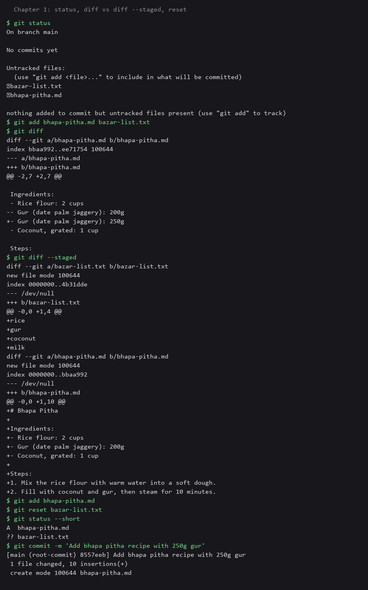
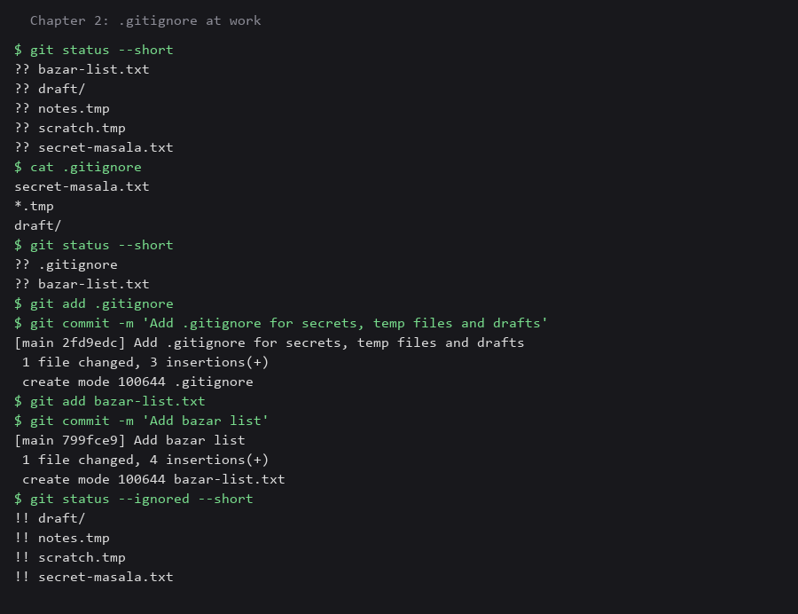
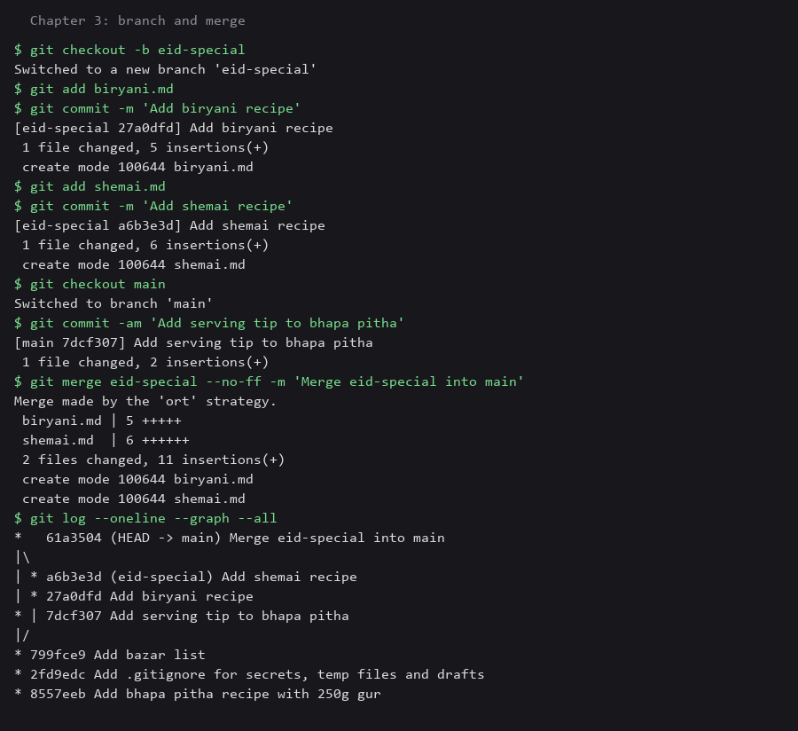
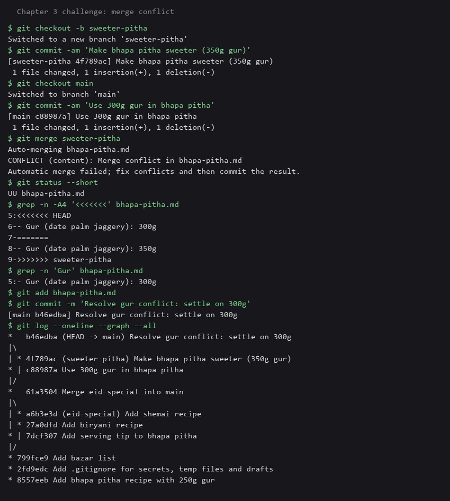
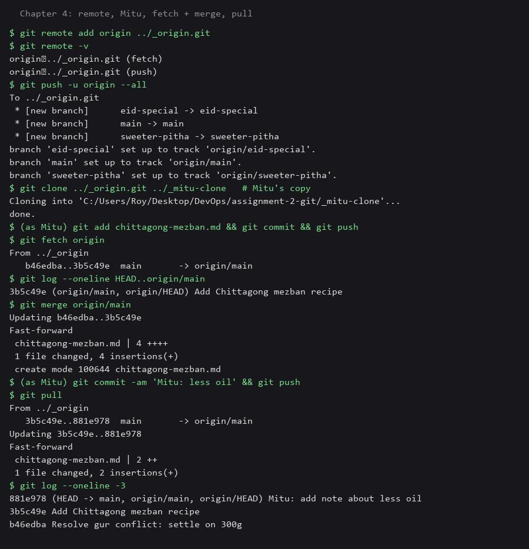
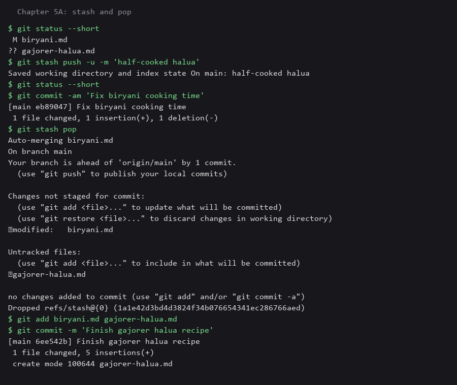
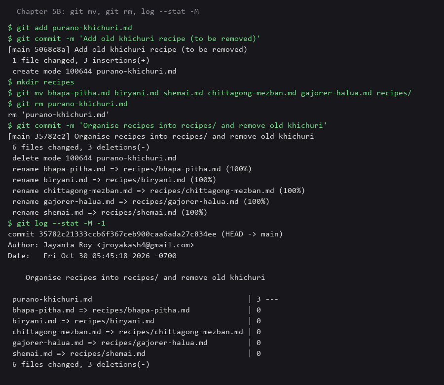
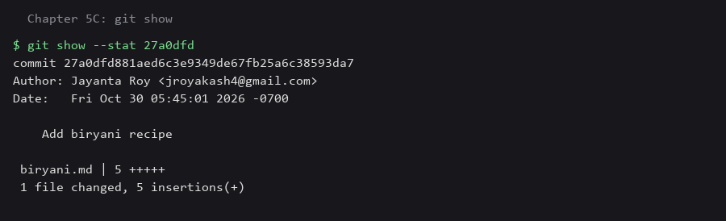
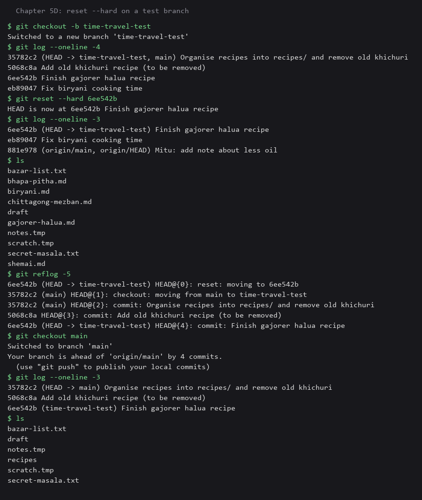
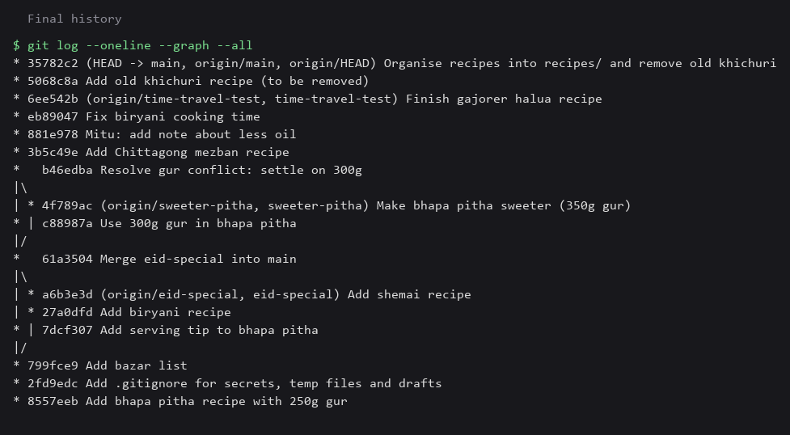

# Nanur Khata (Nanu's Recipe Notebook): my Git story

I followed the story of Nanu keeping her family recipes in Git. Every command below was really run, and the screenshots are renders of the real terminal output. The repo has well over the required 10 commits and several branches (eid-special, main, sweeter-pitha, time-travel-test); the full history is in the graph screenshot at the end.

> Note: the commands ran with a repo-level identity (`git config user.name`) so nothing on the machine was changed. `git config --global` is the same command with the `--global` flag, which applies to every repo.

---

## Chapter 1: The First Recipe

```bash
git init -b main
git config user.name "Roy"
git config user.email "jroyakash4@gmail.com"
git status
git add bhapa-pitha.md bazar-list.txt
git diff                      # unstaged changes only
git diff --staged             # what is ready to commit
git add bhapa-pitha.md
git reset bazar-list.txt      # unstage, file stays on disk
git commit -m "Add bhapa pitha recipe with 250g gur"
```



**What I learned:** After I staged the file and then changed the gur amount from 200g to 250g, `git diff` showed only the new change (working tree vs index) while `git diff --staged` showed the old staged version (index vs last commit). `git reset <file>` removed `bazar-list.txt` from the staging area without deleting it.

## Chapter 2: The Secret Spice

```bash
echo "..." > secret-masala.txt; touch notes.tmp scratch.tmp; mkdir draft
printf 'secret-masala.txt\n*.tmp\ndraft/\n' > .gitignore
git status --short
git add .gitignore && git commit -m "Add .gitignore for secrets, temp files and drafts"
git status --ignored --short
```



**Proof:** before `.gitignore`, `git status` listed the secret file, the `.tmp` files and `draft/`. After it, none of them appear, and `git status --ignored` shows they are ignored rather than missing.

## Chapter 3: The Eid Special

```bash
git checkout -b eid-special
git add biryani.md && git commit -m "Add biryani recipe"
git add shemai.md  && git commit -m "Add shemai recipe"
git checkout main
git merge eid-special --no-ff -m "Merge eid-special into main"
git log --oneline --graph --all
```



I used `--no-ff` so the merge is recorded as its own merge commit, which makes the branch visible in the graph.

### Challenge: a merge conflict on purpose

```bash
git checkout -b sweeter-pitha      # change gur to 350g, commit
git checkout main                  # change gur to 300g on the same line, commit
git merge sweeter-pitha            # CONFLICT
```



**How I resolved it:** both branches changed the same line, so Git could not choose. It put `<<<<<<<`, `=======` and `>>>>>>>` markers in the file. I opened the file, kept one value (300g, the middle ground), deleted the marker lines, ran `git add bhapa-pitha.md` to mark it resolved, and finished with `git commit`.

## Chapter 4: Mitu Joins In

```bash
git remote add origin <url>
git push -u origin --all
git clone <url> ../_mitu-clone      # Mitu's copy
# Mitu adds chittagong-mezban.md, commits and pushes
git fetch origin
git merge origin/main
# Mitu pushes again
git pull
```



(The remote here is a local bare repository standing in for GitHub, so the whole exercise ran offline. It is pointed at GitHub before the final push.)

**fetch + merge vs pull:** `git fetch` only downloads new commits and updates `origin/main`; my own branch and files are untouched, so I can look at `git log HEAD..origin/main` first and decide. `git merge origin/main` then brings them in. `git pull` is both steps in one command (fetch, then merge), which is faster but gives no chance to look before the merge happens.

## Chapter 5: Half-Cooked Halua and Time Travel

### A: git stash

```bash
git stash push -u -m "half-cooked halua"
git commit -am "Fix biryani cooking time"
git stash pop
```



### B: git mv and git rm

```bash
git mv *.md recipes/
git rm purano-khichuri.md
git log --stat -M -1
```



`-M` makes Git detect renames, so the moves appear as `bhapa-pitha.md => recipes/bhapa-pitha.md (100%)` instead of a delete plus an add.

### C: git show

```bash
git show --stat <sha>
```



### D: git reset --hard (on a test branch, never main)

```bash
git checkout -b time-travel-test
git reset --hard <older-commit>
```



**What was lost:** the two newest commits disappeared from the branch, and the files from those commits (the `recipes/` folder move and the removal of the old khichuri file) went back to how they were. `git reflog` still lists the old commits, so they were recoverable, and `main` was untouched.

**Why rebase and `reset --hard` are risky on shared branches:** both rewrite history. If teammates already pulled the old commits, their copies no longer match the branch. A forced push then makes their next pull conflict or duplicates commits, and work can be lost. On a shared branch use `git revert` (a new commit that undoes a change) instead, and keep history rewriting for private branches.

---

## Final history

`git log --oneline --graph --all`, taken right before this screenshot and the story were committed (so the last two documentation commits are not in it):


